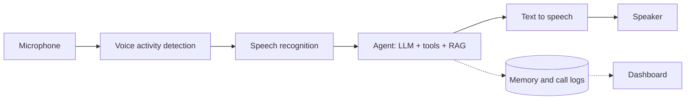
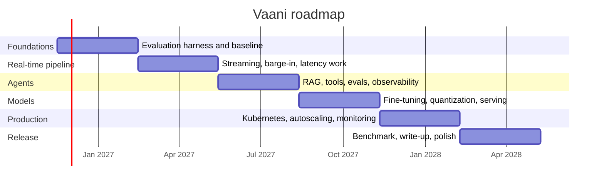

# Vaani by Manas Jain

[](https://github.com/manasjainwork/vaani/actions/workflows/ci.yml)
[](https://manasjainwork.github.io/vaani/)


**A real-time voice agent that talks in Hinglish.** You speak, it understands, thinks, and answers back in voice.

Vaani is built in public on a laptop with an RTX 3050 Ti (4 GB GPU), using only free tools. The goal is simple: build a complete, measured, production-style AI system, and write down every decision in a book that a beginner can read.

Book (docs): https://manasjainwork.github.io/vaani/

## How it will work



1. **Voice activity detection** finds out when you start and stop talking.
2. **Speech recognition** turns your voice into text.
3. **The agent** (a language model with tools and a knowledge base) decides what to say or do.
4. **Text to speech** turns the answer back into voice.
5. **A dashboard** will show latency, memory use, quality scores and call logs.

## Status

Honest status, updated after every milestone.

| Area | State |
|---|---|
| Repository, CI, pre-commit checks | Done |
| Docs site (the book) | Live, chapters being written |
| Evaluation harness (WER for Hinglish) | Next |
| Voice pipeline, version 0 | Planned |
| Fine-tuning, serving, agents, MLOps | Planned |

## Roadmap (18 months)



## Principles

- **Measure first.** Every claim comes with a number, and the number comes with a way to reproduce it.
- **Failures are documented.** What broke and why goes into the book too.
- **Free and reproducible.** No paid services. Anyone can run the checks on their own machine.
- **Simple English.** The docs explain what was built, why, and what alternatives were rejected.

## Quick start

```bash
git clone https://github.com/manasjainwork/vaani.git
cd vaani
uv sync
uv run pytest -q
uv run mkdocs serve
```

This needs [uv](https://docs.astral.sh/uv/) and Python 3.11. The GPU libraries are large, so the first sync takes a while.

## Repository map

| Folder | What lives there |
|---|---|
| `src/vaani/` | The application code |
| `tests/` | Automated tests |
| `bench/`, `eval/` | Benchmarks and evaluation |
| `docs/` | The book |
| `deploy/` | Docker and deployment files |

## License

MIT. See [LICENSE](LICENSE).

---

Built by [Manas Jain](https://github.com/manasjainwork). Feedback and advice are welcome through GitHub issues.
