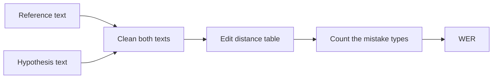

# Chapter 1: Measuring speech accuracy (WER)

## 1. What is this?

When a speech model listens to someone, it writes down what it heard. We need one number that says how good that text is. That number is the **Word Error Rate (WER)**: out of all the words the person really said, how many did the model get wrong? Lower is better, and 0 is perfect.

| | Text |
|---|---|
| What the person said (reference) | mera order kab aayega |
| What the model wrote (hypothesis) | mera order kab ayega |

One word out of four is wrong, so WER is 1 / 4 = 25%.

## 2. What we built

Two small functions in `src/vaani/metrics.py`, and tests for them.



## 3. Why it matters for this project

Every later change (fine-tuning, quantization, streaming) will be judged by WER. If our ruler is wrong, every conclusion is wrong. Hinglish makes the ruler harder to build, because one word can be written in several ways.

## 4. Tech and skills used

- Python standard library only (`unicodedata`, `dataclasses`)
- Dynamic programming (the edit distance table)
- `pytest` for tests
- `jiwer`, a trusted library, only to double-check our own numbers

## 5. Why we chose to write it ourselves

Writing it from scratch teaches us how edit distance really works, and it gives us full control over how text is cleaned (which matters a lot for Hindi). We still compare our results with `jiwer` in a test, so we do not fool ourselves.

## 6. Alternatives we did not pick

| Option | Good | Bad | Why we did not pick it |
|---|---|---|---|
| `jiwer` library | Trusted, fast | We cannot see inside it | Used as a cross-check only |
| `torchmetrics` or Hugging Face `evaluate` | Many metrics in one place | Heavy dependencies | Too much weight for one formula |
| NIST `sclite` | The classic tool | Old, separate install | Hard to run in our CI |
| Character Error Rate (CER) | Gentler on spelling differences | Not the standard headline number | We will add it later next to WER |

## 7. Code walkthrough

### Cleaning the text

```python
--8<-- "src/vaani/metrics.py:normalize"
```

- `unicodedata.normalize("NFC", ...)` makes sure the same letter is stored the same way. Without it, two texts that look equal could count as different words.
- `.lower()` so "Order" and "order" are the same word.
- The loop keeps letters, marks and numbers, and turns everything else (commas, question marks) into spaces.
- We keep **marks** on purpose. In Hindi, vowel signs are marks. If we dropped them, "मेरा" would break into pieces. See the lesson on the Failures page.
- The last line cuts extra spaces.

### Counting the mistakes

```python
--8<-- "src/vaani/metrics.py:wer"
```

The idea: build a table where `dist[i][j]` is the fewest edits needed to turn the first `i` reference words into the first `j` hypothesis words. A tiny example, reference `a b` and hypothesis `a c`:

| | (start) | a | c |
|---|---|---|---|
| (start) | 0 | 1 | 2 |
| a | 1 | 0 | 1 |
| b | 2 | 1 | 1 |

The bottom-right cell is 1: one edit (swap `b` for `c`). WER = 1 / 2 words = 0.5.

- If the two words are equal, the cost is copied from the diagonal cell.
- If they differ, we pay 1 plus the cheapest of three moves: substitute, delete, insert.
- The `while` loop walks back from the bottom-right cell to learn *which kinds* of mistakes happened. This tells us if the model drops words or invents them.
- If the reference is empty we raise an error, because dividing by zero words means nothing.
- Time and memory are both proportional to `n * m` (reference words times hypothesis words).

## 8. Numbers

No model numbers yet. What we can say today: 12 tests pass, and our WER matches `jiwer` on 300 random sentence pairs. Real Hinglish numbers arrive in Week 2.

## 9. What went wrong and what we learned

Python's normal regex word character (`\W`) cut Hindi words into pieces: "मेरा ऑर्डर कब आएगा" turned into "म र ऑर डर कब आएग". Reason: Hindi vowel signs are Unicode marks, not letters. Lesson: never trust a regex on Indian scripts without testing real Hindi text.

Still unsolved: WER treats "kya", "क्या" and "kia" as three different words, so spelling and script variants inflate the error. Next steps are script and spelling normalization, and Character Error Rate next to WER.

## 10. How to explain this in an interview

**30-second answer:** "I wrote WER from scratch using edit distance with dynamic programming, and I cross-checked it against jiwer on random data. The interesting part was text cleaning for Hinglish: a normal regex broke Hindi words, so I used Unicode categories instead."

**Follow-up questions:**

1. *Can WER be above 100%?* Yes. If the model adds many extra words, insertions can be more than the reference length.
2. *Why not just use jiwer?* I wanted to understand every line and control the cleaning. I still use jiwer in a test as a cross-check.
3. *How does it handle Hinglish spelling variants?* Not yet. Right now different spellings count as errors. The plan is script and spelling normalization, plus CER.
