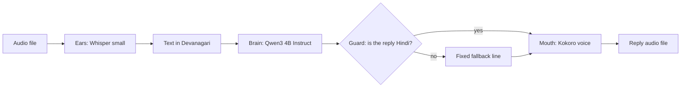

# Chapter 2: The first talking agent

## 1. What is this?

A voice agent is three helpers working one after another. The **ears** turn speech into text. The **brain** decides what to say. The **mouth** turns the answer into voice.

This chapter builds the first version. It is not real time yet: you give it a recorded audio file, and it gives you back an audio file with the reply.

Example: the customer says "bhai mera order kab aayega". The agent replies in Hindi and asks for the order number.

## 2. What we built



Files: `scripts/say.py` (the mouth), `scripts/agent_demo.py` (all three together), and `scripts/llm_probe.py` (a small experiment tool we used to debug the brain).

## 3. Why it matters for this project

Every later improvement (streaming, a GPU, fine-tuning, tools) plugs into one of these three slots. Running all three once also shows where the time goes.

## 4. Tech and skills used

- Whisper small through `faster-whisper` (CPU, 8-bit) for the ears
- Qwen3-4B-Instruct-2507 (4-bit) through Ollama for the brain
- Kokoro (82M parameters) with the Hindi voice `hf_beta` for the mouth
- Python standard library for the HTTP call, prompt design, a guard check, and timing each stage

## 5. Why we chose these

- **Ears:** Whisper is the strongest open speech model that fits this laptop.
- **Brain:** it must speak Hindi and fit in 4 GB of GPU memory. A 4B model in 4-bit fits. We use the "Instruct-2507" version because it does not write long thinking before it answers, and a phone call cannot wait for that.
- **Mouth:** Kokoro is small, has an open licence, and has Hindi voices. One listener picked `hf_beta` out of four voices. We will repeat this test with family members, without telling them which voice is which.

## 6. Alternatives we did not pick

| Option | Good | Bad | Why we did not pick it |
|---|---|---|---|
| Qwen3-4B (the "thinking" version) | Good Hindi | Wrote long English reasoning before answering | Too slow and messy for a call |
| Other small models (Gemma, Llama) | Might speak Hindi better | Not tested yet | We will compare them later on the same clips |
| IndicF5 (voice) | One benchmark author found it natural | Heavier (330M parameters), needs text preprocessing | Not tried yet |
| Indic Parler-TTS (voice) | Good quality reported | 0.9B parameters, heavy for 4 GB | Not tried yet |
| Piper Hindi (voice) | Very small | Rated poor in one project's comparison | Not tried yet |

"Not tried yet" is honest: those rows are plans, not results.

## 7. Code walkthrough

### The prompt

```python
--8<-- "scripts/agent_demo.py:prompt"
```

- The first lines give the agent a job and a place (a phone call), so answers stay short.
- "Hindi, written in Devanagari" is there because our Hindi voice reads Devanagari best.
- "Use only the order data below. Never invent" is there because in our first test the model made up delivery times ("24 hours" once, "48 hours" another time).
- "If the customer did not give an order number, ask for it" and "if it is not in the data, offer a human" give the agent safe things to do when it does not know.
- "May contain wrong words" tells the model that the speech recognizer makes mistakes.
- The order data is fake and only for testing.

### Asking the brain

```python
--8<-- "scripts/agent_demo.py:ask"
```

- We write the chat format ourselves (ChatML, the format Qwen was trained on) and send it in `raw` mode. Ollama's own chat template hid this model's answers, see the Failures page.
- `stop` tells the model to stop at the end of its turn.
- `temperature` 0.2 keeps answers steady. `num_predict` 120 caps the length, because spoken replies should be short.
- The function also returns the stop reason and token count. Those two numbers are what helped us find the bug.

### The language guard

```python
--8<-- "scripts/agent_demo.py:guard"
```

- It counts Devanagari letters and English letters. If the reply is not mostly Hindi (or is empty), the agent speaks a fixed line instead of reading nonsense out loud.
- It is cheap but not perfect: a Hindi reply with the wrong meaning still passes.

## 8. Numbers

Measured on our 5 clips from one speaker, with Whisper and Kokoro on the CPU. Only a first look.

| Stage | Time per clip (after warm-up) |
|---|---|
| Ears (Whisper small) | 2.2 to 5.4 s |
| Brain (Qwen3 4B Instruct, 4-bit) | 2.4 to 4.0 s (the very first call took 15.1 s because the model was loading) |
| Mouth (Kokoro) | 1.6 to 2.4 s |
| Whole turn | 6.7 to 10.4 s |

The target for the real-time version is around 2 seconds, so there is a long way to go. The ears are the biggest part.

Calling the brain three ways (10 calls each):

| Way of calling | Empty answers |
|---|---|
| Chat endpoint, default | 10 of 10 |
| Chat endpoint, "think" switched off | 6 of 10 |
| Raw ChatML, written by hand | 0 of 10 |

Whisper repeatability: after fixing the random seed, the same clip gave the same text in two runs (checked on one clip only).

## 9. What went wrong and what we learned

- **The brain's answers came back empty.** Ollama's chat template hid them. Writing the format by hand fixed it. Details on the Failures page.
- **Whisper wrote different text on each run.** Fixing the random seed made it repeatable. Details on the Failures page.
- **The agent found the right order from a garbled number, by luck.** It picked the first order in its list. With a different order number it could have shown someone else's order. Lesson: read the number back and ask the customer to confirm before sharing any details.
- **Requests outside its job** (an appointment, a payment problem, an address change) all got "please give your order number". The agent needs a clear rule for what it cannot do.

## 10. How to explain this in an interview

**30-second answer:** "I built a three-stage Hinglish voice agent that runs on a 4 GB laptop: Whisper for speech, a 4B Qwen model through Ollama, and Kokoro for the voice. The most useful part was debugging. The model's answers were empty because Ollama's chat template hid them, so I wrote the chat format by hand, and I added a guard so the agent never speaks non-Hindi text. One turn takes 7 to 10 seconds today, so the next work is streaming."

**Follow-up questions:**

1. *Why raw mode?* Ollama's template treated this model as a thinking model and hid its answer, or made it stop after one token. I compared three ways of calling it, and writing the format myself gave 0 empty answers in 10 calls.
2. *How do you stop the agent from making up facts?* It only sees fake order data, it is told never to invent, and it must ask for the order number. Next I will make it read numbers back for confirmation and test it with wrong and garbled numbers.
3. *Why is it slow, and what will you change?* The ears take the most time because Whisper runs on the CPU. Next: run Whisper on the GPU, stream the audio in small pieces, and start speaking as soon as the first sentence is ready.
